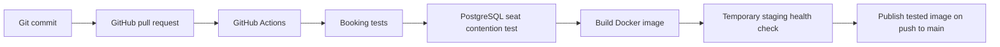

# Tatkal Shield


A college DevOps showcase about one passenger question: **Did my booking go through when the connection dropped?** Tatkal Shield lets a passenger hold a seat, confirm it, lose the acknowledgement and recover the original PNR.

[Watch the DevOps film](frontend/jury/devops.mp4) · [Watch the passenger story](frontend/jury/tatkal-shield.mp4) · [View CI runs](https://github.com/Tanishk2773/tatkal-sheild/actions/workflows/booking.yml)

The passenger booking interface adapts the [Flight Ticket Booking Web Figma Community template](https://www.figma.com/community/file/1592189951122278094/flight-ticket-booking-web) for train journeys.

## Run on your computer

Install Git and Node.js 22.16 or newer (npm comes with Node.js). Use a GitHub account with access to this private repository. [Download Git](https://git-scm.com/downloads) · [Download Node.js](https://nodejs.org/en/download)

**1. Get the project.** Open a terminal and run:

```sh
git clone https://github.com/Tanishk2773/tatkal-sheild.git
cd tatkal-sheild
```

If you already have the project, open a terminal in the folder containing `package.json` and start at step 2.

**2. Install dependencies and start the server.**

```sh
npm ci
npm start
```

On Windows, if PowerShell blocks `npm.ps1`, use `npm.cmd ci` and `npm.cmd start`. The default demo runs with an in-memory database and serves the frontend and API together.

**3. Open the app.** Keep the terminal running and use these links on the same computer:

- [Booking app](http://127.0.0.1:3000/) — click **Book a ticket**, choose your passenger count, and pick **Mumbai CSMT → Pune Junction** under **Try a demo route**. Select one seat per passenger. You can create a passenger account when prompted.
- [Jury presentation](http://127.0.0.1:3000/jury/) — use the separate presentation site to walk through the problem statement, backend contention and recovery scenarios, and the GitHub Actions pipeline. The narrated DevOps film remains available.
- [Health check](http://127.0.0.1:3000/api/health) — the default demo returns `"status":"ok"` and `"storage":"demo-memory"`.

Press **Ctrl+C** in the terminal to stop the server. Run `npm start` from the same folder to start it again. Restarting clears demo accounts and tickets. For persistent storage, copy [.env.example](.env.example) to `.env`, set `DATABASE_URL` to an existing PostgreSQL database, and restart.

**If port 3000 is busy**, set `PORT=3010` in the project's `.env` file, restart, and use the address printed in the terminal. [Booking app on port 3010](http://127.0.0.1:3010/)

**If sign-in says “API endpoint not found”**, check [the passenger endpoint](http://127.0.0.1:3000/api/passenger) on the same port as the app. Before you sign in, the current server returns `{"passenger":null}`. A 404 usually means an older server is still listening on that port. Start the current checkout on another port or stop the old server if you no longer need its in-memory data. Open the **Local** address printed by the new process.

## Try the jury demonstration

1. In the Operations Lab, enable **Drop the next confirmation reply**.
2. Search **CSMT → MAO** on the suggested demo date, choose a train and class.
3. Create a passenger account or sign in. Choose a class, enter fictional passenger details and pay with the demo wallet while the five-minute hold is active.
4. Refresh the same browser tab and choose **Retrieve paid ticket**. Open **My tickets** to see the PNR.

## What the project contains

| Area | What you can do |
| --- | --- |
| Journey planner | Search 49 selected Indian railway stations by name, code or a supported alias. Nine mock services supply the bookable inventory. |
| Passenger accounts | Sign in to view your own ticket history, move a booking to a free seat on the same demo train, or cancel it and release the seat. Passwords are salted and hashed with scrypt. The server validates the session cookie for booking requests. |
| Coach and booking service | Inspect free, held and sold seats. Holds expire after five minutes. Transactions, ownership checks and a unique seat constraint protect confirmations. |
| Recovery drill | Drop a successful response in the browser, reload and retry. A matching confirmation returns the existing PNR. |
| Operations Lab | Inspect the health-probe response time, free seats and active holds. Follow an interactive explanation of the failure. |
| Interface | Explore the animated railway map backdrop and booking interface with reduced-motion support. |
| Jury materials | The companion presentation is served at `/jury/`. Both narrated MP4 films are bundled with the app. |

Station names and codes are reference data. Schedules, inventories and tickets are simulated. The project has no live RailOne booking integration.

## Classes and QR checkout

Each search opens a results view. The nine demo services cover Mumbai–Pune, Mumbai–Madgaon, Delhi–Lucknow and Bengaluru–Mysuru. Choose a train, compare the four class fares, and enter details and berth preferences for up to six passengers in one class. The passenger account owns the ticket. The server assigns available berths automatically and tries to honor each preference. One QR payment covers the group. Each passenger receives a separate PNR and an assigned seat number, and each ticket can be cancelled independently. Retrying a confirmation returns the original set of PNRs.

The QR opens a browser-based demo wallet. On one computer, use **Pay with demo wallet** directly. For a phone demonstration, bind the server to a reachable interface and set `PUBLIC_ORIGIN` to the reachable site origin before starting. A phone cannot reach a computer through its loopback address.

Set the optional server-side `RAILKIT_API_KEY` for RailKit station-pair timetable references alongside simulated search results. The three bundled YouPI skill documents cover an Android gateway, a banking observer and a security audit. They are integration references. The running wallet uses demo funds. The supplied YouPI guide requires merchant credentials and manual bank verification for real settlement. [Integration references](docs/integrations)

Run the HTTP and database tests with `npm test`. To exercise the booking screens at desktop and mobile widths, run `npx playwright-core install chromium`, then `npm run test:browser`. The browser suite starts an isolated demo database and decodes the payment QR.

### What the jury can verify

- **Concurrency:** PostgreSQL locks booking writes for the selected train. Concurrent groups competing for the same seat produce one complete hold. The rejected group keeps none of those seats.
- **Recovery:** A browser test drops the confirmation after payment and verifies that both original PNRs return after refresh. The other browser run decodes the QR and pays from the wallet page.
- **Delivery:** GitHub Actions runs the suite locally and again against the Docker release candidate backed by PostgreSQL. Only the tested image is published to GitHub Container Registry.
- **Health:** `/api/live` checks that the web process responds. `/api/health` checks database readiness and is used by Docker. CI captures staging logs and stops the container after the smoke test.

## How a change reaches staging



The PostgreSQL check races two passengers for one seat and retries the winning confirmation. A successful push to `main` publishes the tested image to GitHub Container Registry with the commit SHA as its tag. Temporary staging lives for the duration of the Actions job. [Workflow](.github/workflows/booking.yml) · [Database test](backend/ci/postgres.js)

## Hosting

The [Render Blueprint](render.yaml) defines a Docker web service, an internal PostgreSQL connection, HTTPS session cookies and an HTTP readiness probe. Both resources request the free plan. Render requires access to this private repository before provisioning. [Deploy to Render](https://render.com/deploy?repo=https://github.com/Tanishk2773/tatkal-sheild)

## Development checks

After installing dependencies, run the syntax checks and automated booking tests from the project folder.

```sh
npm run check
npm test
```

## Project layout

| Directory | Contents |
| --- | --- |
| [frontend](frontend/) | Booking UI, station directory, animations and [jury materials](frontend/jury/) |
| [backend/src](backend/src/) | HTTP routes, passenger sessions and booking transactions |
| [backend/sql](backend/sql/) | Database schema |
| [backend/tests](backend/tests/) | HTTP acceptance, authorization and retry tests |
| [.github/workflows](.github/workflows/) | CI, temporary staging and image delivery |

## Upstream projects

The original RailKit and YouPI ZIPs are preserved locally in `integrations/upstream/`. Keep them outside the web root and open them separately to work with their original package layouts. The archives include their own infrastructure, test tooling and mobile code. Tatkal Shield uses the RailKit npm package and the YouPI merchant session API.

- **Rail information** exposes the RailKit lookups for trains, stations, fares, availability, PNR, running status and other timetable data. Set `RAILKIT_API_KEY` on the server to connect the feed.
- **YouPI sandbox** opens a merchant checkout from the payment screen when all four `YOUPI_SANDBOX_*` variables in [.env.example](.env.example) are set. Configure a YouPI test deployment and use test credentials. The server uses the order’s fare and an idempotency key. Tatkal Shield tickets are issued by the local demo wallet.
## Run the primary website in Docker

```sh
docker compose up -d --build --wait
docker compose ps
```

Open [the booking website](http://localhost:3011/) or [the jury showcase](http://localhost:3011/jury/). Only the Nginx gateway is published on the host. The app, PostgreSQL and the booking event worker communicate on the Compose network. `docker compose down` stops the stack and preserves the PostgreSQL volume.

### How the two architecture PDFs map to the demo

| Area | Implemented in Tatkal Shield | Further work from the PDFs |
| --- | --- | --- |
| Admission | Per-account and per-journey/class in-flight limits protect berth allocation. Excess requests receive a retry response without imposing a shared-IP quota at checkout. | Distributed waiting room, device attestation and passkeys |
| Availability | Overlapping train list reads share one database operation. | SSE updates and threshold-based availability |
| Inventory | PostgreSQL serializes allocation, matches berth preferences and holds the entire group together. The burst gate checks that 20 competing groups cannot overbook six berths. | Redis Lua segment masks, fencing versions and partitioned inventory |
| Payment | Demo QR checkout uses an expiring hold and returns the existing PNRs when confirmation is retried. | Bank-backed UPI mandates and compensation workflows |
| Booking events | Confirmation writes an outbox event in the booking transaction. A separate worker fills an idempotent local projection. | Kafka, Debezium, reconciliation and authorized CRIS integration |

### CI and delivery

GitHub Actions runs API and browser tests, checks allocation races on PostgreSQL, builds the commit SHA image with Buildx, scans it with Trivy, and runs checkout and outbox checks on disposable Compose staging. Successful pushes to `main` publish the exact tested image to GHCR.

The optional Jenkins pipeline accepts a published commit SHA image, tests it with its own disposable PostgreSQL volume, and pauses for approval before promotion. The Jenkins agent needs Docker Compose, Node.js, Chromium system dependencies, curl, jq and registry access. Configure `BOOKING_DEPLOY_DIR` as the existing demo Compose directory on that Docker host. Promotion checks the running SHA via `/api/health` and restores the previous image if the check fails. A single app replica may experience a brief interruption during replacement.
