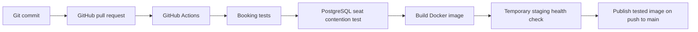

# Tatkal Shield


A college DevOps showcase about one passenger question: **Did my booking go through when the connection dropped?** Tatkal Shield lets a passenger hold a seat, confirm it, lose the acknowledgement and recover the original PNR.

[Watch the DevOps film](frontend/jury/devops.mp4) · [Watch the passenger story](frontend/jury/tatkal-shield.mp4) · [View CI runs](https://github.com/Tanishk2773/tatkal-sheild/actions/workflows/booking.yml)

## Run on your computer

Install Git and Node.js 22.16 or newer (npm comes with Node.js). Use a GitHub account with access to this private repository. [Download Git](https://git-scm.com/downloads) · [Download Node.js](https://nodejs.org/en/download)

**1. Get the project.** Open a terminal and run:

```sh
git clone https://github.com/Tanishk2773/tatkal-sheild.git
cd tatkal-sheild
```

If you already have the project, open a terminal in the folder containing `package.json` and start at step 2.

**2. Install dependencies and start the server.**

```sh
npm ci
npm start
```

On Windows, if PowerShell blocks `npm.ps1`, use `npm.cmd ci` and `npm.cmd start`. The default demo runs with an in-memory database and serves the frontend and API together.

**3. Open the app.** Keep the terminal running and use these links on the same computer:

- [Booking app](http://127.0.0.1:3000/) — choose **Mumbai CSMT → Pune Junction** under **Try a demo route**, pick the train, and select a seat. You can create a passenger account when prompted.
- [Jury presentation](http://127.0.0.1:3000/jury/) — open the walkthrough or play the narrated DevOps film.
- [Health check](http://127.0.0.1:3000/api/health) — the default demo returns `"status":"ok"` and `"storage":"demo-memory"`.

Press **Ctrl+C** in the terminal to stop the server. Run `npm start` from the same folder to start it again. Restarting clears demo accounts and tickets. For persistent storage, copy [.env.example](.env.example) to `.env`, set `DATABASE_URL` to an existing PostgreSQL database, and restart.

**If port 3000 is busy**, set `PORT=3010` in the project's `.env` file, restart, and use the address printed in the terminal. [Booking app on port 3010](http://127.0.0.1:3010/)

**If sign-in says “API endpoint not found”**, check [the passenger endpoint](http://127.0.0.1:3000/api/passenger) on the same port as the app. Before you sign in, the current server returns `{"passenger":null}`. A 404 usually means an older server is still listening on that port. Start the current checkout on another port or stop the old server if you no longer need its in-memory data. Open the **Local** address printed by the new process.

## Try the jury demonstration

1. In the Operations Lab, enable **Drop the next confirmation reply**.
2. Search **CSMT → MAO** on the suggested demo date, choose a train and select an available seat.
3. Create a passenger account or sign in. Confirm the five-minute hold.
4. Refresh the same browser tab and choose **Retrieve confirmation**. Open **My account → My tickets** to see the PNR.

## What the project contains

| Area | What you can do |
| --- | --- |
| Journey planner | Search 49 selected Indian railway stations by name, code or a supported alias. Three mock services supply the bookable inventory. |
| Passenger accounts | Sign in to view your own ticket history, move a booking to a free seat on the same demo train, or cancel it and release the seat. Passwords are salted and hashed with scrypt. The server validates the session cookie for booking requests. |
| Coach and booking service | Inspect free, held and sold seats. Holds expire after five minutes. Transactions, ownership checks and a unique seat constraint protect confirmations. |
| Recovery drill | Drop a successful response in the browser, reload and retry. A matching confirmation returns the existing PNR. |
| Operations Lab | Inspect the health-probe response time, free seats and active holds. Follow an interactive explanation of the failure. |
| Interface | Replay a train arrival, rotate the 3D train and explore a layered animated landscape. Reduced-motion support is included. |
| Jury materials | The companion presentation is served at `/jury/`. Both narrated MP4 films are bundled with the app. |

Station names and codes are reference data. Schedules, inventories and tickets are simulated. The project has no live RailOne booking integration.

## How a change reaches staging



The PostgreSQL check races two passengers for one seat and retries the winning confirmation. A successful push to `main` publishes the tested image to GitHub Container Registry with the commit SHA as its tag. Temporary staging lives for the duration of the Actions job. [Workflow](.github/workflows/booking.yml) · [Database test](backend/ci/postgres.js)

## Hosting

The [Render Blueprint](render.yaml) defines a Docker web service, an internal PostgreSQL connection, HTTPS session cookies and an HTTP readiness probe. Both resources request the free plan. Render requires access to this private repository before provisioning. [Deploy to Render](https://render.com/deploy?repo=https://github.com/Tanishk2773/tatkal-sheild)

## Development checks

After installing dependencies, run the syntax checks and automated booking tests from the project folder.

```sh
npm run check
npm test
```

## Project layout

| Directory | Contents |
| --- | --- |
| [frontend](frontend/) | Booking UI, station directory, animations and [jury materials](frontend/jury/) |
| [backend/src](backend/src/) | HTTP routes, passenger sessions and booking transactions |
| [backend/sql](backend/sql/) | Database schema |
| [backend/tests](backend/tests/) | HTTP acceptance, authorization and retry tests |
| [.github/workflows](.github/workflows/) | CI, temporary staging and image delivery |
