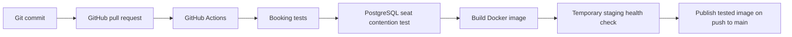

# Tatkal Shield


A college DevOps showcase about one passenger question: **Did my booking go through when the connection dropped?** Tatkal Shield lets a passenger hold a seat, confirm it, lose the acknowledgement and recover the original PNR.

[Watch the DevOps film](frontend/jury/devops.mp4) · [Watch the passenger story](frontend/jury/tatkal-shield.mp4) · [View CI runs](https://github.com/Tanishk2773/tatkal-sheild/actions/workflows/booking.yml)

## Try the jury demonstration

1. In the Operations Lab, enable **Drop the next confirmation reply**.
2. Search **CSMT → MAO** on the suggested demo date, choose a train and select an available seat.
3. Create a passenger account or sign in. Confirm the five-minute hold.
4. Refresh the same browser tab and choose **Retrieve confirmation**. Open **My account → My tickets** to see the PNR.

## What the project contains

| Area | What you can do |
| --- | --- |
| Journey planner | Search 49 selected Indian railway stations by name, code or a supported alias. Three mock services supply the bookable inventory. |
| Passenger accounts | Register, sign in, sign out and view your own ticket history. Passwords are salted and hashed with scrypt. The server validates the session cookie for booking requests. |
| Coach and booking service | Inspect free, held and sold seats. Holds expire after five minutes. Transactions, ownership checks and a unique seat constraint protect confirmations. |
| Recovery drill | Drop a successful response in the browser, reload and retry. A matching confirmation returns the existing PNR. |
| Operations Lab | Inspect the health-probe response time, free seats and active holds. Follow an interactive explanation of the failure. |
| Interface | Replay a train arrival, rotate the 3D train and explore a layered animated landscape. Reduced-motion support is included. |
| Jury materials | The companion presentation is served at `/jury/`. Both narrated MP4 films are bundled with the app. |

Station names and codes are reference data. Schedules, inventories and tickets are simulated. The project has no live RailOne booking integration.

## How a change reaches staging



The PostgreSQL check races two passengers for one seat and retries the winning confirmation. A successful push to `main` publishes the tested image to GitHub Container Registry with the commit SHA as its tag. Temporary staging lives for the duration of the Actions job. [Workflow](.github/workflows/booking.yml) · [Database test](backend/ci/postgres.js)

## Hosting

The [Render Blueprint](render.yaml) defines a Docker web service, an internal PostgreSQL connection, HTTPS session cookies and an HTTP readiness probe. Both resources request the free plan. Render requires access to this private repository before provisioning. [Deploy to Render](https://render.com/deploy?repo=https://github.com/Tanishk2773/tatkal-sheild)

## Development

Use Node.js 22 or newer.

```sh
npm ci
npm run check
npm test
npm start
```

Express serves the app and API together. Set `DATABASE_URL` for persistent PostgreSQL. With no database URL the app uses pg-mem and resets accounts and bookings on restart. See [.env.example](.env.example) for the local configuration.

| Directory | Contents |
| --- | --- |
| [frontend](frontend/) | Booking UI, station directory, animations and [jury materials](frontend/jury/) |
| [backend/src](backend/src/) | HTTP routes, passenger sessions and booking transactions |
| [backend/sql](backend/sql/) | Database schema |
| [backend/tests](backend/tests/) | HTTP acceptance, authorization and retry tests |
| [.github/workflows](.github/workflows/) | CI, temporary staging and image delivery |
